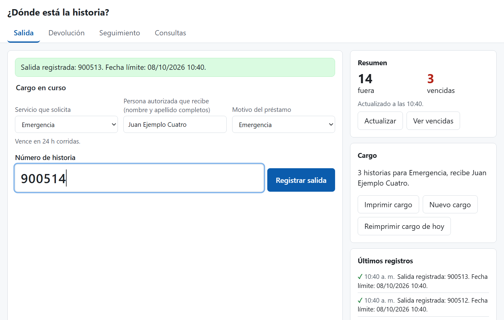
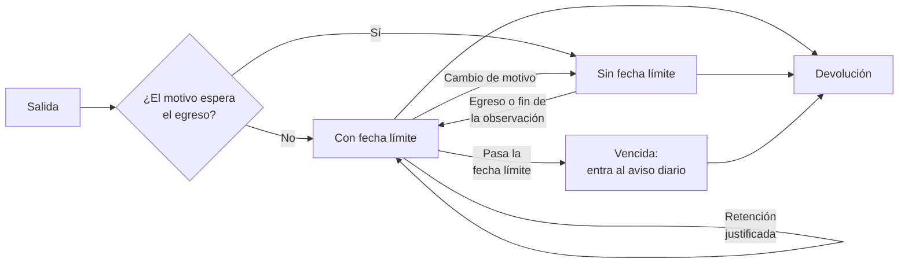
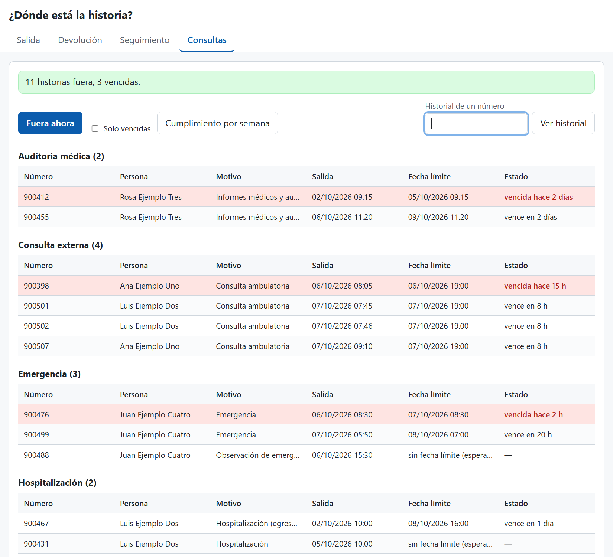

# ¿Dónde está la historia?

[](https://github.com/ygallardops/donde-esta-la-historia/actions/workflows/pruebas.yml)
[](LICENSE)


Herramienta para apoyar el control de préstamos de historias clínicas físicas según la NTS N.° 139-MINSA/2018/DGAIN, «Norma Técnica de Salud para la Gestión de la Historia Clínica».

Registra la salida y la devolución de cada historia, calcula la fecha límite según los plazos que configure la IPRESS y genera el cargo para la firma de quien recibe. Funciona con Google Sheets y Apps Script, sin instalar software.

> [!WARNING]
> En desarrollo. No debe usarse con datos reales sin la aprobación formal de la IPRESS. No es un desarrollo oficial de ninguna institución.



Las capturas de este documento usan datos ficticios.

## Contenido

- [Cómo funciona](#cómo-funciona)
- [Qué hace](#qué-hace)
- [Instalación](#instalación)
- [Configuración](#configuración)
- [Demostración](#demostración)
- [Estructura](#estructura)
- [Pruebas](#pruebas)
- [Licencia](#licencia)

## Cómo funciona

Cada préstamo empieza con una salida y termina con una devolución. Entre ambas, la fecha límite depende del motivo del préstamo:



1. La salida se registra con el número de historia, el servicio, la persona que recibe y el motivo. Con eso se calcula la fecha límite y se arma el cargo para la firma.
2. Las historias de hospitalización y de observación en emergencia quedan sin fecha límite hasta que se registra el egreso o el fin de la observación.
3. Una retención justificada reemplaza la fecha límite por una nueva y guarda el motivo.
4. La devolución cierra el préstamo y registra la integridad de la historia.

La pestaña Consultas muestra en todo momento qué historias están fuera y cuáles vencieron:



## Qué hace

- Registra salidas y devoluciones por número de historia, desde el teclado: número y Enter, sin esperar a que termine cada registro.
- Rechaza la salida de una historia que ya figura prestada y la devolución de una que no lo está.
- Calcula la fecha límite con plazos configurables y la ajusta al horario del archivo.
- Propone el motivo habitual de cada servicio y muestra el plazo que implica.
- Registra la integridad de la historia devuelta, el cambio de tipo, el egreso o fin de la observación y la retención justificada.
- Genera un cargo imprimible y permite reimprimir el cargo del día.
- Muestra las historias fuera, con las vencidas marcadas y el tiempo que falta o que lleva vencida cada una, y el historial de un número.
- Resume en la pestaña Salida cuántas historias están fuera y cuántas vencidas.
- Registra el ingreso de una historia sin salida registrada y mide por semana el cumplimiento del registro de salidas.
- Envía un aviso diario de historias vencidas a un espacio de Google Chat.
- Solo admite las cuentas autorizadas en la hoja.
- Guarda solo el número de historia: sin nombre del paciente ni diagnóstico.

El diseño completo, con las fuentes normativas de cada plazo, está en [docs/diseno/control-prestamos.md](docs/diseno/control-prestamos.md).

## Instalación

Requisitos: Node.js, [clasp](https://github.com/google/clasp) (probado con la versión 3.4) y la API de Apps Script activada en la [configuración de la cuenta](https://script.google.com/home/usersettings) que será propietaria de la hoja.

1. Clonar el repositorio e iniciar sesión con la cuenta propietaria:

   ```bash
   git clone https://github.com/ygallardops/donde-esta-la-historia.git
   ```

   ```bash
   clasp login
   ```

2. Desde la carpeta del repositorio, crear el proyecto de Apps Script:

   ```bash
   clasp create --type standalone --title "Donde esta la historia" --rootDir src
   ```

   > [!WARNING]
   > `clasp create` reemplaza `src/appsscript.json` por un manifiesto genérico, sin la zona horaria ni la configuración de la aplicación web. Hay que restaurarlo antes de subir el código.

3. Restaurar el manifiesto y subir el código. `--force` evita la pregunta de confirmación por el cambio de manifiesto:

   ```bash
   git restore src/appsscript.json
   ```

   ```bash
   clasp push --force
   ```

4. Abrir el editor con `clasp open-script` y ejecutar la función `prepararHoja`: crea la hoja con una configuración de ejemplo y los activadores. La dirección de la hoja queda en el registro de ejecución.
5. Revisar en la hoja los plazos, el horario, los servicios, el formato del número y las cuentas autorizadas (ver [Configuración](#configuración)).
6. En el editor, <kbd>Implementar</kbd> → <kbd>Nueva implementación</kbd> → <kbd>Aplicación web</kbd>, ejecutada como la cuenta propietaria. En una IPRESS, el acceso se restringe a su dominio.
7. Opcional: para el aviso diario, crear un webhook en un espacio de Google Chat (requiere una cuenta Business o Enterprise de Google Workspace) y guardarlo en la propiedad del script `WEBHOOK_CHAT`. Sin ella, el aviso queda en el registro de ejecución.

`.clasp.json` está en `.gitignore`: no se sube al repositorio.

<details>
<summary>Permisos que solicita el script</summary>

La primera vez, Google pide autorizar el script. Los necesita para:

- crear la hoja de cálculo, leerla y escribir en ella;
- crear los activadores del aviso diario y de la caché de configuración;
- enviar el aviso al webhook de Google Chat;
- conocer el correo de la cuenta que registra cada movimiento.

</details>

## Configuración

Todo se configura en la hoja que crea `prepararHoja`. Los cambios se aplican al guardar.

| Pestaña | Columnas | Formato |
| --- | --- | --- |
| `plazos` | `tipo`, `forma`, `horas` | `forma` es `fin_del_dia`, `horas`, `horas_desde_alta` o `manual`. `horas` es obligatorio y mayor que cero en `horas` y `horas_desde_alta` |
| `servicios` | `servicio`, `motivo` | `motivo` es opcional y debe coincidir con un `tipo` de `plazos`. Si falta, la página pide elegirlo en cada salida |
| `horario` | `dia`, `apertura`, `cierre` | Día en minúsculas (`lunes` a `domingo`) y horas como `07:00`. Sin horas, ese día no abre. Cada feriado es una fila con `feriado` en `dia` y la fecha como `2026-12-25` en `apertura` |
| `configuracion` | `clave`, `valor` | `formato_numero` es una expresión regular sin `^` ni `$`. `quitar_ceros` es `sí` o `no` |
| `usuarios` | `correo` | Una cuenta autorizada por fila |
| `movimientos` | | La escribe la página. No se edita a mano |

Cada IPRESS debe comprobar los plazos de ejemplo contra la NTS y sus propias disposiciones.

Las propiedades del script se editan en el editor, en <kbd>Configuración del proyecto</kbd>:

| Propiedad | Uso |
| --- | --- |
| `ID_HOJA` | Identificador de la hoja. La guarda `prepararHoja` |
| `WEBHOOK_CHAT` | Dirección del webhook de Google Chat para el aviso diario (opcional) |
| `DEMO` | En `sí`, permite generar datos sintéticos. Solo para hojas de prueba |

## Demostración

En una hoja de prueba, nunca en una con datos reales: poner la propiedad del script `DEMO` en `sí` y ejecutar `generarDatosSinteticos`. Agrega préstamos de las últimas cuatro semanas con números de historia, personas y cuentas inventados.

## Estructura

```text
.
├── src
│   ├── reglas.js          Reglas sin dependencias de Google: fecha límite, formato del número, duplicados, cargo, consultas y aviso
│   ├── app.js             Capa de Apps Script: hoja, registro, consultas, aviso y configuración
│   ├── pagina.html        Página de Salida, Devolución, Seguimiento y Consultas
│   ├── demo.js            Datos sintéticos para la demostración
│   └── appsscript.json    Manifiesto de Apps Script (zona horaria, entorno de ejecución y aplicación web)
├── test
│   └── reglas.test.js     Pruebas de las reglas
├── docs
│   ├── diseno             Documento de diseño
│   └── *.png              Capturas de este documento
└── .github/workflows      Ejecución de las pruebas en GitHub Actions
```

## Pruebas

Requieren Node.js (probado con la versión 24), sin dependencias:

```bash
node --test
```

GitHub Actions las ejecuta en cada push y pull request.

## Licencia

[MIT](LICENSE)
